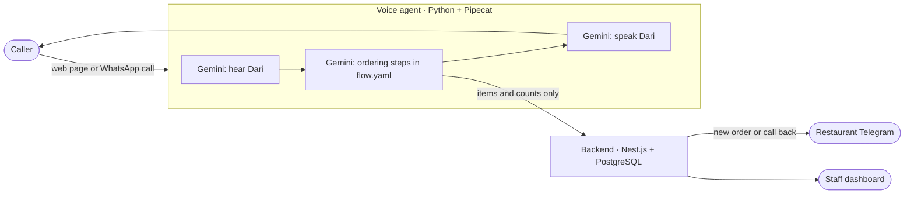

# Awaz Demo

A Dari-speaking AI agent that answers a restaurant's calls, takes the order,
reads it back with exact prices, saves it, and sends it to the restaurant on
Telegram. Built by Awaz as an investor demo.

Customers reach it two ways:

- **Web call page** at `/order`: one tap, then talk, like a phone call.
- **WhatsApp calls** to the restaurant's WhatsApp Business number (optional,
  needs Meta approval; see [docs/whatsapp.md](docs/whatsapp.md)).



## What a call sounds like

1. The agent greets the caller in Dari, says it is the restaurant's AI
   assistant and that the call is recorded.
2. The caller orders in their own words, Dari mixed with English is fine.
   Every item is checked against the menu; nothing off the menu can be added.
3. The agent asks for name, address and a nearby landmark (and a phone number
   for web callers; WhatsApp callers' numbers are already known).
4. It reads back the items and the total. **All prices come from the
   backend**, never from the AI.
5. The caller confirms; the restaurant gets the order on Telegram, and the
   caller hears the order number and delivery time.
6. If the agent misunderstands twice, the caller asks for a person, or saving
   fails, the agent hands over: staff get a "call back" alert instead.

## Repository

| Folder | What it is |
| --- | --- |
| [`agent/`](agent) | Voice agent: Pipecat 1.12, Gemini speech-to-text, LLM and text-to-speech. The conversation steps are in [`flow.yaml`](agent/flow.yaml), the tools in [`handlers.py`](agent/handlers.py), the call page in [`web/order.html`](agent/web/order.html). |
| [`backend/`](backend) | Nest.js + PostgreSQL (Drizzle ORM): menu, orders, call logs, Telegram alerts, staff dashboard at `/dashboard`. |
| [`docs/`](docs) | [Deploying to a VPS](docs/deploy.md), [WhatsApp setup](docs/whatsapp.md), [testing and the investor numbers](docs/testing.md). |

## Try it on your laptop (10 minutes, only a Gemini key)

You need Python 3.11+ and [uv](https://docs.astral.sh/uv/).

```bash
cd agent
cp ../.env.example .env        # then put your GOOGLE_API_KEY in it
uv sync
uv run bot.py
```

Open <http://localhost:7860/order> in Chrome, press the call button and order
in Dari. Without `BACKEND_URL` the agent runs in standalone mode: it uses the
sample menu in `sample_menu.json` and writes orders to `agent/data/orders.jsonl`.

To run the full system (backend, dashboard, Telegram) locally, see
[backend/README.md](backend/README.md), then set `BACKEND_URL` and
`AGENT_API_KEY` in `agent/.env`.

## Put it online

See [docs/deploy.md](docs/deploy.md): a Contabo VPS, a domain, `.env`, and
`docker compose up -d --build`. Microphones only work on HTTPS pages, so the
setup includes Caddy, which gets a free certificate automatically.

## Tests

```bash
cd agent && uv run pytest                      # 37 tests: menu, cart, tools, whole calls
cd backend && npm test                         # unit tests
TEST_DATABASE_URL=postgres://... npm run test:e2e   # API tests against PostgreSQL
```

The agent tests drive complete calls through the real flow and tools with a
simulated LLM, so they run without a key or network. How well Gemini hears
Herati Dari can only be measured with real recordings; see
[docs/testing.md](docs/testing.md).

## Known limits

- Dari recognition quality is unmeasured until you run the 30-call test in
  [docs/testing.md](docs/testing.md). Gemini's transcription model is not
  advertised for Dari specifically.
- No real phone number yet: Afghan operators need a business agreement for a
  SIP line. WhatsApp and the web page cover the demo.
- One restaurant per deployment. Several restaurants need a `restaurant_id`
  on the menu and orders.
- The voice is a stock Gemini voice; a custom Herati voice is in Plan A.
